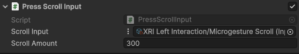

# Press Scroll Input

Takes a directional press, such as a hand tracking microgesture swipe or a button press, and outputs a single scroll of a fixed distance. Any component that reads a `Vector2` input can use it.

Holding a press outputs one scroll. To scroll again, release it and press again.

To scroll UI with an interactor, refer to [Scroll UI with XR input](xref:xri-ui-scrolling#scroll-with-single-presses-and-microgestures).

 *The Press Scroll Input showing all properties.*

## Press Scroll Input properties

The Press Scroll Input contains the following properties:

| **Property** | **Description** |
| :--- | :--- |
| **Scroll Input** | The direction to scroll in, such as a **2D Vector** composite of microgesture swipes or buttons. Only the direction is used. |
| **Scroll Amount** | The distance each press scrolls, in pixels, on a scroll view with default settings. Refer to [Scroll distance](xref:xri-ui-scrolling#scroll-distance) to scale it per scroll view. |

## Bind Scroll Input

**Scroll Input** reads a direction (`Vector2`).

* **Microgestures**: bind a **2D Vector** composite to the hand's swipes: **Up** to `swipeForward`, **Down** to `swipeBackward`, **Left** to `swipeLeft`, and **Right** to `swipeRight`. Add an **Invert Vector 2** processor with **Invert Y** disabled, so horizontal swipes scroll the same direction as the thumbstick. The **Microgesture Scroll** actions in the Starter Assets sample are set up this way, one for each hand.
* **Buttons or a D-pad**: bind them to a **2D Vector** composite. Only bind the directions you need, such as **Up** and **Down** for two face buttons.
* **Thumbstick**: add a **Stick Deadzone** processor to the binding. Without it, the stick rarely returns exactly to zero, so the next push doesn't count as a new press. Return the stick to center between scrolls.

> [!NOTE]
> Microgesture bindings only work with the **Hand Interaction Profile Microgestures** feature enabled in the OpenXR settings.

## Additional resources

* [Scroll UI with XR input](xref:xri-ui-scrolling)
* [`PressScrollInput` class](xref:UnityEngine.XR.Interaction.Toolkit.Inputs.PressScrollInput)
* [Input readers](xref:xri-input-readers)
* [Component index](xref:xri-components)
