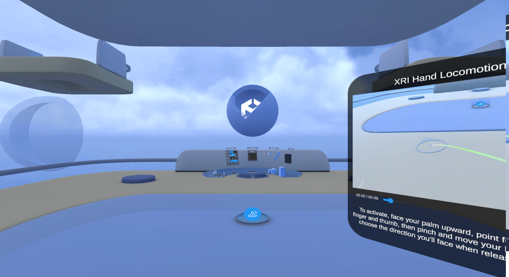
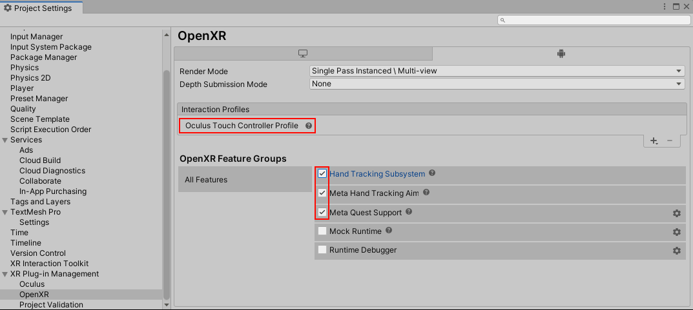
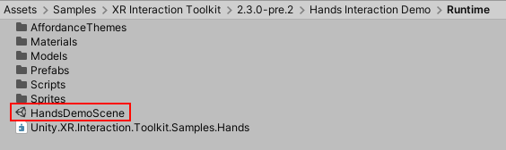
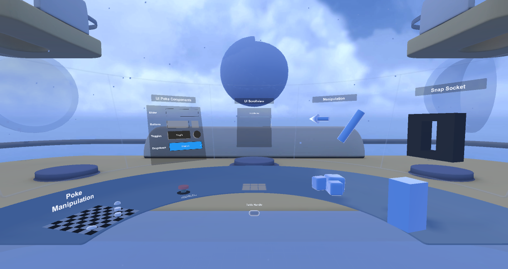
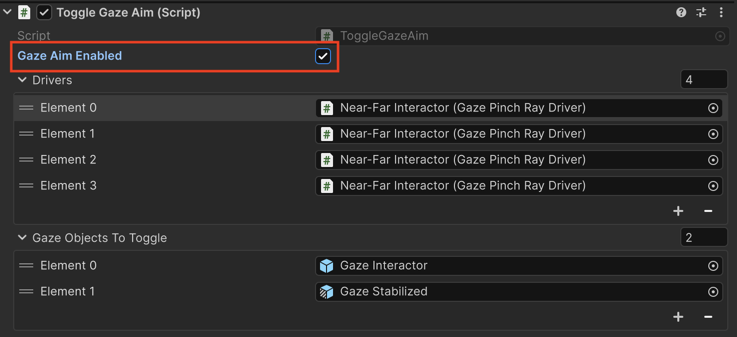
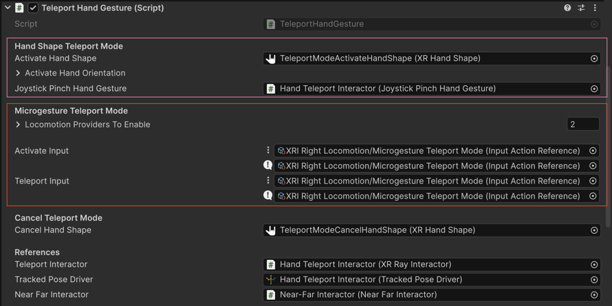
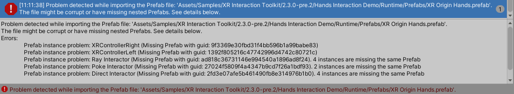
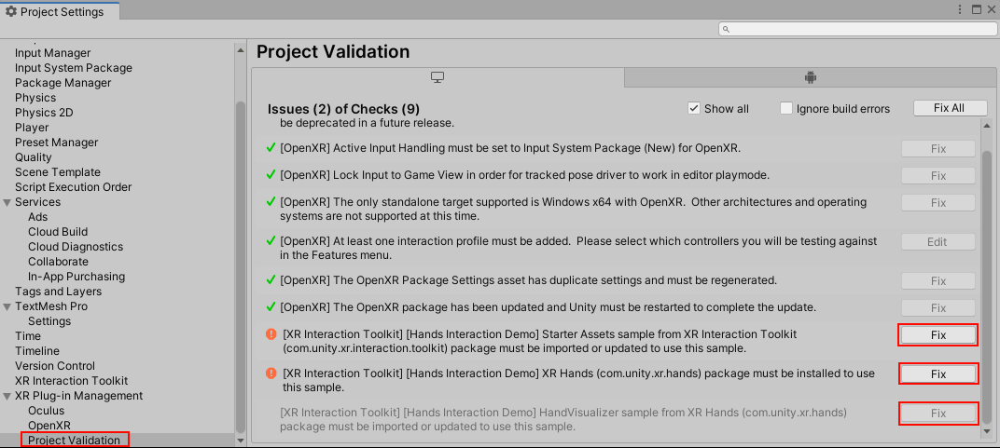
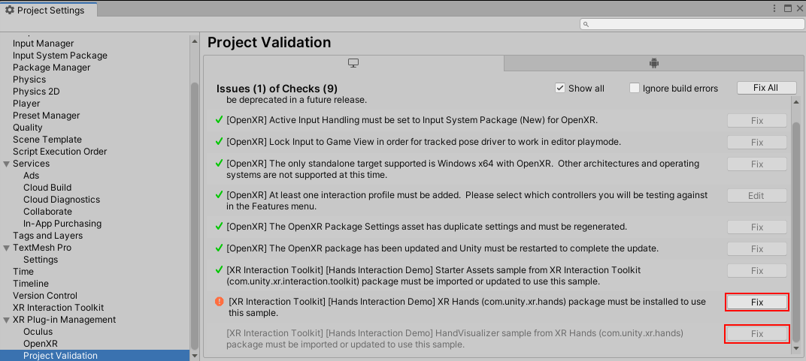
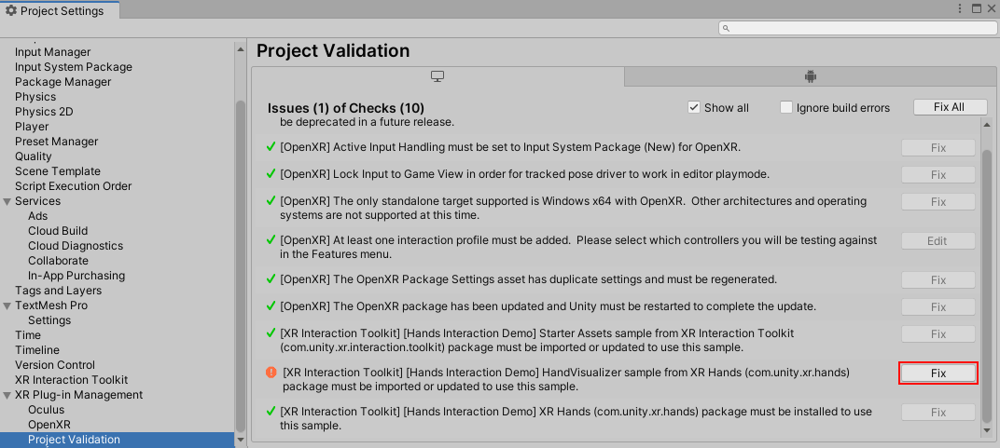

# Hands Interaction Demo

This sample demonstrates hand tracking interactions with the XR Interaction Toolkit, containing a sample scene and other assets used by the scene.

This sample is installed into the default location for package samples, in the `Assets\Samples\XR Interaction Toolkit\[version]\Hands Interaction Demo` folder. You can move these Assets to a different location.

[!include]

|**Asset**|**Description**|
|---|---|
|**`AffordanceThemes\`**|Asset folder containing Affordance Theme Datums used by [Affordance receivers](affordance-system.md#affordance-receivers) in the hand visuals. An example is coloring finger tips upon interaction.|
|**`DatumPresets\`**|Asset folder containing Follow Preset Datums used by hand menus.|
|**`DemoAssets\`**|Asset folder containing assets only used for the `HandsDemoScene`.|
|**`Editor\Scripts\`**|Asset folder containing Unity Editor scripts which adds Project Validation rules for the sample.|
|**`Materials\`**|Asset folder containing materials for hand visuals.|
|**`Models\`**|Asset folder containing models for hand visuals.|
|**`Prefabs\`**|Asset folder containing prefabs of hand visuals and a hand variant of the XR Origin (XR Rig).|
|**`Scripts\`**|Asset folder containing scripts to detect gestures.|
|**`Shaders\`**|Asset folder containing shaders for hand visuals.|
|**`Textures\`**|Asset folder containing textures for hand visuals.|
|**`HandsDemoScene`**|Scene that illustrates a basic rig setup that supports hand tracking and controllers along with example interactable objects and UI.|

## Prerequisites and setup

In order for this sample to function properly, a few additional packages and samples are required. Install these by clicking **Fix** in **Edit** &gt; **Project Settings** &gt; **XR Plug-in Management** &gt; **Project Validation** or by using the **Window** &gt; **Package Manager** window. See [Install XR Hands](https://docs.unity3d.com/Packages/com.unity.xr.hands@latest/index.html?subfolder=/manual/project-setup/install-xrhands.html) for installation steps for that package when using the Package Manager window.
  * [Starter Assets](samples-starter-assets.md) sample - imported from Package Manager under XR Interaction Toolkit in the Samples area
  * [OpenXR Plugin (com.unity.xr.openxr)](https://docs.unity3d.com/Manual/com.unity.xr.openxr.html) - 7.0.0-pre.1 or newer
  * [XR Hands (com.unity.xr.hands)](https://docs.unity3d.com/Manual/com.unity.xr.hands.html) - 7.0.0-pre.1 or newer
    * HandVisualizer - imported from Package Manager under XR Hands in the Samples area
  * [Shader Graph](https://docs.unity3d.com/Manual/com.unity.shadergraph.html) - For the materials used on the rendered hands

To enable hand tracking support with an OpenXR project, enable the **OpenXR** plug-in provider in **Edit** &gt; **Project Settings** &gt; **XR Plug-in Management**. Then open **Edit** &gt; **Project Settings** &gt; **XR Plug-in Management** &gt; **OpenXR** and enable [Hand Tracking Subsystem](xref:xrhands-openxr-hands-feature) under OpenXR Feature Groups.

### Meta Quest support via OpenXR

If building for Meta Quest headsets, you will also need to enable [Meta Quest Support](xref:openxr-meta-quest-support) (only available in the Android tab) and [Meta Hand Tracking Aim](xref:xrhands-meta-aim-feature). Then add an Interaction Profile in that same window, such as [Oculus Touch Controller Profile](xref:openxr-oculus-touch-controller-profile), for controller support.

### Eye tracking support via OpenXR

[Gaze aim](#gaze-aim) reads eye gaze from the OpenXR Eye Gaze Interaction Profile. To use it, open **Edit** &gt; **Project Settings** &gt; **XR Plug-in Management** &gt; **OpenXR** and add the **Eye Gaze Interaction Profile** to **Enabled Interaction Profiles**. Without it, gaze aim falls back to the hand and controller aim rays.

Eye tracking also needs a runtime permission on Meta Quest and Android XR. In the `HandsDemoScene` hierarchy, select **Permissions Manager** and enable `com.oculus.permission.EYE_TRACKING` for Meta Quest or `android.permission.EYE_TRACKING_FINE` for Android XR. Both are disabled by default. Accept the permission prompt when the app launches.

> [!NOTE]
> You might also need to turn on eye tracking in the device's settings. Refer to your device vendor's documentation.

### Microgesture support via OpenXR

[Microgesture UI scrolling](#microgesture-ui-scrolling) and [microgesture locomotion](#microgesture-locomotion) read thumb taps and swipes from the OpenXR Hand Interaction Profile. To use them, open **Edit** &gt; **Project Settings** &gt; **XR Plug-in Management** &gt; **OpenXR** and enable the **Hand Interaction Profile Microgestures** feature. Without it, the rest of the sample works as usual.

For how each microgesture is defined, refer to [XR_META_hand_tracking_microgestures](https://registry.khronos.org/OpenXR/specs/1.1/html/xrspec.html#XR_META_hand_tracking_microgestures) in the OpenXR specification.

> [!NOTE]
> Microgestures require OpenXR Plugin 7.0.0-pre.1 or newer.

The main Hands Interaction Demo scene can be opened from the location `Assets\Samples\XR Interaction Toolkit\[version]\Hands Interaction Demo\HandsDemoScene`. This scene uses the assets in the list below. The prefabs are designed as a starting point for your own XR hand interaction based projects.

## Demo scene layout

In the `HandsDemoScene` there are multiple interaction areas. On the right side you will find objects to interact with and manipulate. You will need to use a pinch gesture to pick up and move them around the table. The blocks on the table can be thrown, but the floating objects remain in place. When pinching with two hands, the floating objects can be scaled and rotated. The socket will snap objects into place when grabbed and brought close.

On the left and center of the scene you will find the UI interactions. The UI elements can be interacted with in 2 ways:
  * Ray & Pinch: UI can be clicked by pointing the hand Ray Interactor and then bringing your index finger and thumb together in a pinch gesture to activate selection.
  * Poke: UI can also be clicked by pressing into the UI with your index finger. Some UI buttons have included the Poke Follow Affordance sample script which uses the finger depth to depress the UI buttons.

On the far left of the scene you will find chess pieces that can be poked and then moved around the surface.

The handle below the table allows you to reposition the whole table when grabbed and moved.

## Hierarchy configuration

The XR Origin Hands (XR Rig) in this scene supports either motion controllers or hand tracking, which is managed by the XR Input Modality Manager component.

A Poke Gesture Detector component and Meta System Gesture Detector component are on the hand tracking GameObjects which manages automatically toggling interactors to disable them and their visuals by activating or deactivating those child GameObjects when the hand is making certain gestures.

The Hand Visualizer GameObject uses the HandVisualizer sample component from the [XR Hands](https://docs.unity3d.com/Manual/com.unity.xr.hands.html) package to visually represent the hands.

See Starter Assets [Hierarchy configuration](samples-starter-assets.md#hierarchy-configuration) for the base prefab hierarchy.

<table>
<thead>
  <tr>
    <th colspan="5">GameObject</th>
    <th>Components</th>
    <th>Description</th>
  </tr>
</thead>
<tbody>
  <tr>
    <td colspan="5"><strong>XR Origin Hands (XR Rig)</strong></td>
    <td>See base prefab.</td>
    <td>Variant of the XR Origin (XR Rig) prefab that adds support for tracked hands. The XR Input Modality Manager is overridden to add references to Left Hand and Right Hand.</td>
  </tr>
  <tr>
    <td rowspan="20"></td>
    <td colspan="4"><strong>Camera Offset</strong></td>
    <td>See base prefab.</td>
    <td>See base prefab.</td>
  </tr>
  <tr>
    <td rowspan="17"></td>
    <td colspan="3"><strong>Main Camera</strong></td>
    <td>See base prefab.</td>
    <td>See base prefab.</td>
  </tr>
  <tr>
    <td colspan="3"><strong>Gaze Interactor</strong></td>
    <td>See base prefab.</td>
    <td>See base prefab.</td>
  </tr>
  <tr>
    <td colspan="3"><strong>Gaze Stabilized</strong></td>
    <td>See base prefab.</td>
    <td>See base prefab.</td>
  </tr>
  <tr>
    <td colspan="3"><strong>Left</strong>/<strong>Right Controller</strong></td>
    <td>See base prefab.</td>
    <td>See base prefab.</td>
  </tr>
  <tr>
    <td colspan="3"><strong>Left</strong>/<strong>Right Controller Stabilized</strong></td>
    <td>See base prefab.</td>
    <td>See base prefab.</td>
  </tr>
  <tr>
    <td colspan="3"><strong>Left</strong>/<strong>Right Hand</strong></td>
    <td>
      <a href="xr-interaction-group.md">XR Interaction Group</a>

      Poke Gesture Detector

      Meta System Gesture Detector

      <a href="https://docs.unity3d.com/Manual/class-AudioSource.html">Audio Source</a>
    </td>
    <td>Represents the interaction groups for tracked hand-based interaction. The Poke Gesture Detector is used to mediate between poke and ray pinch interactions. The Meta System Gesture Detector is used to disable interactions while doing menu palm pinch gestures. The Audio Source is used as an example response to the menu palm pinch gesture.</td>
  </tr>
  <tr>
    <td rowspan="10"></td>
    <td colspan="2"><strong>Poke Interactor</strong></td>
    <td>
      <a href="xr-poke-interactor.md">XR Poke Interactor</a>

      <a href="https://docs.unity3d.com/Packages/com.unity.inputsystem@latest?subfolder=/api/UnityEngine.InputSystem.XR.TrackedPoseDriver.html">Tracked Pose Driver</a>
    </td>
    <td>Interactor used for interacting with interactables by poking. Pose driven by the index finger's tip.</td>
  </tr>
  <tr>
    <td colspan="2"><strong>Direct Interactor</strong></td>
    <td>
      <a href="xr-direct-interactor.md">XR Direct Interactor</a>

      <a href="https://docs.unity3d.com/Manual/class-SphereCollider.html">Sphere Collider</a>

      <a href="https://docs.unity3d.com/Packages/com.unity.inputsystem@latest?subfolder=/api/UnityEngine.InputSystem.XR.TrackedPoseDriver.html">Tracked Pose Driver</a>
    </td>
    <td>Interactor used for interacting with interactables by pinching at close range. The Sphere Collider is configured as a trigger collider and used by the XR Direct Interactor to detect collisions with interactables. Has a Tracked Pose Driver to set the Position action to use the pinch position of the hand.</td>
  </tr>
  <tr>
    <td colspan="2"><strong>Ray Interactor</strong></td>
    <td>
      <a href="xr-ray-interactor.md">XR Ray Interactor</a>

      <a href="https://docs.unity3d.com/Manual/class-LineRenderer.html">Line Renderer</a>

      <a href="xr-interactor-line-visual.md">XR Interactor Line Visual</a>

      <a href="https://docs.unity3d.com/Manual/class-SortingGroup.html">Sorting Group</a>

      <a href="https://docs.unity3d.com/Packages/com.unity.inputsystem@latest?subfolder=/api/UnityEngine.InputSystem.XR.TrackedPoseDriver.html">Tracked Pose Driver</a>
    </td>
    <td>Interactor used for interacting with interactables by pinching at a distance. Uses physics ray casts to detect collisions with interactables. The Sorting Group is used to make the line visual draw in the expected order over UI. Has a Tracked Pose Driver to set the Position and Rotation actions to use the Meta Hand Tracking Aim feature.</td>
  </tr>
  <tr>
    <td colspan="2"><strong>Poke Stabilized Attach</strong></td>
    <td><a href="xr-transform-stabilizer.md">XR Transform Stabilizer</a></td>
    <td>Stabilized left or right poke pose used as the Attach Transform of the XR Poke Interactor.</td>
  </tr>
  <tr>
    <td colspan="2"><strong>Direct Stabilized Attach</strong></td>
    <td><a href="xr-transform-stabilizer.md">XR Transform Stabilizer</a></td>
    <td>Stabilized left or right pinch pose used as the Attach Transform of the XR Direct Interactor.</td>
  </tr>
  <tr>
    <td colspan="2"><strong>Ray Stabilized</strong></td>
    <td><a href="xr-transform-stabilizer.md">XR Transform Stabilizer</a></td>
    <td>Stabilized left or right aim pose used as the Ray Origin Transform of the XR Ray Interactor.</td>
  </tr>
  <tr>
    <td rowspan="1"></td>
    <td><strong>Ray Stabilized Attach</strong></td>
    <td></td>
    <td>Stabilized pose used as the Attach Transform of the XR Ray Interactor.</td>
  </tr>
  <tr>
    <td colspan="2"><strong>Pinch Point Stabilized</strong></td>
    <td>
      Pinch Point Follow

      <a href="xr-interactor-affordance-state-provider.md">XR Interactor Affordance State Provider</a>

      Hide Object When Interactor Blocked
    </td>
    <td>Stabilized left or right pinch dropper pose used as the Line Origin Transform of the XR Interactor Line Visual on the Ray Interactor.</td>
  </tr>
  <tr>
    <td rowspan="1"></td>
    <td><strong>Pinch Visual</strong></td>
    <td>
      <a href="https://docs.unity3d.com/Manual/class-SkinnedMeshRenderer.html">Skinned Mesh Renderer</a>

      Multiple <a href="affordance-system.md#affordance-receivers">Affordance Receivers</a>
    </td>
    <td>Pinch dropper visual.</td>
  </tr>
  <tr>
    <td colspan="2"><strong>Left/Right Hand Quest/Android XR Visual</strong></td>
    <td>
      <a href="https://docs.unity3d.com/Packages/com.unity.xr.hands@latest/index.html?subfolder=/manual/hand-data/xr-hand-access-data.html">XR Hand Tracking Events</a>

      <a href="https://docs.unity3d.com/Packages/com.unity.xr.hands@latest/index.html?subfolder=/manual/hand-data/xr-hand-visuals.html#xr-hand-mesh-controller">XR Hand Mesh Controller</a>

      <a href="https://docs.unity3d.com/Packages/com.unity.xr.hands@latest/index.html?subfolder=/manual/hand-data/xr-hand-visuals.html#xr-hand-skeleton-driver">XR Hand Skeleton Driver</a>

      <a href="xr-hand-skeleton-poke-displacer.md">XR Hand Skeleton Poke Displacer</a>
    </td>
    <td>Adds hand interaction shader affordances that highlight the hand and fingers during interactions.</td>
  </tr>
  <tr>
    <td colspan="3"><strong>Hand Visualizer</strong></td>
    <td><a href="https://docs.unity3d.com/Packages/com.unity.xr.hands@latest/index.html#samples">Hand Visualizer</a></td>
    <td>Visual representation of the tracked hands.</td>
  </tr>
  <tr>
    <td colspan="4"><strong>Locomotion</strong></td>
    <td>See base prefab.</td>
    <td>See base prefab.</td>
  </tr>
  <tr>
    <td colspan="4"><strong>Hands Smoothing Post Processor</strong></td>
    <td>Hands One Euro Filter Post Processor</td>
    <td>Filters and smooths the position of the tracked hands.</td>
  </tr>
</tbody>
</table>

## Gaze aim

Gaze aim lets you target objects and UI by looking at them, then select with your hand or controller, such as with a pinch or a controller button. You can also scroll the UI you look at with microgesture swipes. Your hands can rest in your lap, and you don't need to aim a ray. It suits UI and far objects, and works alongside near interaction such as direct poking and grabbing.

Gaze aim is off by default, so hands and controllers aim with their own rays.

With gaze aim on:

* Look at an object or UI element, then pinch or press the select button to select it.
* Keep holding to grab the object or drag a slider or scroll view. Move your hand or controller to move it.

Reaching out and grabbing nearby objects works the same with gaze aim on.

If eye tracking isn't available, gaze aim automatically falls back to the hand and controller aim rays, the same as with gaze aim off.

### Turn on gaze aim

Select the root of the `XR Origin Hands (XR Rig)` and enable **Gaze Aim Enabled** on the Toggle Gaze Aim component. You can also set `ToggleGazeAim.gazeAimEnabled` from a script at runtime. Eye gaze needs the setup in [Eye tracking support via OpenXR](#eye-tracking-support-via-openxr).

Use XR Hands 7.0.0-pre.1 or newer, so the hand aim pose updates correctly when the ray falls back to the hand.

To test gaze aim on a device that doesn't support eye tracking, you can simulate eye gaze with the head pose. On the rig's **Gaze Interactor** GameObject, enable **Fallback If Eye Tracking Unavailable** in the Gaze Input Manager component. It's off by default.

### Gaze aim configuration

> [!IMPORTANT]
> Don't use the [XR Gaze Interactor](xref:xri-xr-gaze-interactor) or [XR Gaze Assistance](xref:xri-xr-gaze-assistance) components for gaze aim. They're meant for other use cases, such as gaze hover and dwell selection or helping hand and controller rays snap to what you look at. The XR Gaze Interactor component on the Gaze Interactor GameObject of the `XR Origin Hands (XR Rig)` is disabled by default. Avoid using them in parallel with gaze aim.

#### Toggle Gaze Aim

The Toggle Gaze Aim component on the rig's root switches the rig between gaze aim and hand or controller aim.

|**Property**|**Description**|
|---|---|
|**Gaze Aim Enabled**|Whether users target objects by looking at them, instead of with their hands or controllers.|
|**Drivers**|The Gaze Pinch Ray Driver components on the Near-Far Interactors that aim their rays with gaze. They're enabled while gaze aim is on.|
|**Gaze Objects To Toggle**|The GameObjects to activate while gaze aim is on, such as the Gaze Interactor and Gaze Stabilized GameObjects of the XR Origin.|

#### Gaze Pinch Ray Driver

The Gaze Pinch Ray Driver sets the **Cast Origin** of the Near-Far Interactor's far caster. While gaze is available and nothing is selected, the far ray casts from the gaze pose. On select, the ray moves to the aim pose of the hand or controller, turned toward the point you were looking at, and turns with the hand or controller until you release. The near caster, select input, and attach point of the Near-Far Interactor are unchanged.

Each Gaze Pinch Ray Driver must be under an XR Origin that has a **Camera Floor Offset Object**. Otherwise, it logs an error and disables itself.

|**Property**|**Description**|
|---|---|
|**Near Far Interactor**|The Near-Far Interactor whose far ray this component drives. If not set, uses the Near-Far Interactor on the same GameObject.|
|**Aim Pose**|The aim pose of the hand or controller, used while gaze isn't available or while selecting. If not set, uses the far caster's cast origin.|
|**Gaze Pose**|The gaze pose the far ray casts from while gaze is available, such as the Gaze Stabilized GameObject of the XR Origin.|
|**Gaze Input Manager**|The Gaze Input Manager that reports whether gaze is available.|
|**Gaze Lost Delay**|Seconds that gaze must stay unavailable before the far ray falls back to the aim pose.|
|**Gaze Regained Delay**|Seconds that gaze must stay available before the far ray returns from the aim pose to gaze.|
|**Objects To Hide While Using Gaze**|Objects to hide while the far ray casts from gaze, such as the ray's line visual.|

## Microgesture UI scrolling

With the [microgesture feature](#microgesture-support-via-openxr) enabled, you can scroll UI with thumb swipes. Point a hand at a scroll view, then swipe your thumb forward, backward, left, or right along your index finger to scroll it. Each swipe scrolls a fixed distance and glides to a stop. Swipes work with uGUI Scroll Rects, UI Toolkit Scroll Views, and dropdown lists.

Each hand has a **Microgesture Scroll Input** GameObject with a [Press Scroll Input](press-scroll-input.md) component that reads the `Microgesture Scroll` action of that hand's `XRI Left Interaction` or `XRI Right Interaction` action map. The hand's Near-Far Interactor uses it as its **UI Scroll Input**, with **UI Scroll Momentum** enabled. Controllers still scroll with the thumbstick.

To set up microgesture scrolling in your own rig, refer to [Scroll with single presses and microgestures](xref:xri-ui-scrolling#scroll-with-single-presses-and-microgestures). To change how far each swipe scrolls, change **Scroll Amount** on the Press Scroll Input, or [tune each scroll view](xref:xri-ui-scrolling#scroll-distance).

## Microgesture locomotion

The sample is set up to demonstrate how to teleport, snap turn, and step with thumb taps and swipes on the right hand. With the [microgesture feature](#microgesture-support-via-openxr) enabled, use these gestures:

|**Gesture**|**Result**|
|---|---|
|Tap your thumb on your index finger.|Enters teleport mode. The teleport ray appears once you release the tap.|
|Swipe left or right, in teleport mode.|Snap turns 45° in that direction.|
|Swipe forward or backward, in teleport mode.|Steps 0.5 meters in that direction.|
|Tap again, in teleport mode.|Teleports to the reticle. You stay in teleport mode, so you can keep moving.|
|Make the cancel hand shape.|Exits teleport mode. Swipes no longer move you.|

A tap doesn't enter teleport mode while the hand holds an object or points at UI you can select or scroll, so taps and swipes still work on UI. While in teleport mode, the hand's Near-Far Interactor is disabled, so swipes move you instead of scrolling UI.

> [!NOTE]
> To change how far each swipe turns or steps, set **Turn Amount** on the [Snap Turn Provider](snap-turn-provider.md) of the **Microgesture Snap Turn** GameObject, or **Step Distance** on the [Step Move Provider](step-move-provider.md) of the **Microgesture Step** GameObject.

### Microgesture locomotion configuration

The Teleport Hand Gesture component on the **Hand Teleport Interactor** GameObject under the **Right Hand** controls teleport mode. The microgesture actions are in the `XRI Right Locomotion` action map of the `XRI Default Input Actions` asset.

The Teleport Hand Gesture component supports two teleport modes that share the same cancel hand shape, an open palm by default:

- **Hand shape teleport mode**: enter with a hand shape, then aim and teleport by pinching.
- **Microgesture teleport mode**: driven by microgesture actions. Enter with a thumb tap, aim with your hand, then tap again to teleport. Swipe left or right to snap turn, and forward or backward to step.

|**Teleport Hand Gesture property**|**Description**|
|---|---|
|**Locomotion Providers To Enable**|The locomotion providers enabled only in microgesture teleport mode. On the rig, these are the **Microgesture Snap Turn** GameObject's [Snap Turn Provider](snap-turn-provider.md) and the **Microgesture Step** GameObject's [Step Move Provider](step-move-provider.md). Both are disabled the rest of the time.|
|**Activate Input**|The input that activates microgesture teleport mode, such as a thumb tap. Uses the `Microgesture Teleport Mode` action.|
|**Teleport Input**|The input that teleports in microgesture teleport mode. When teleport mode is activated by the hand shape, the teleport interactor's own select input is used.|
|**Cancel Hand Shape**|The hand shape that deactivates both hand shape and microgesture teleport mode.|

The `Microgesture Snap Turn` and `Microgesture Step` actions read the same right-hand swipes. They use a Sector interaction so that snap turn only responds to left and right swipes, and step only responds to forward and backward swipes.

## Troubleshooting

If you find yourself in an error state when trying to import the packages, it can be helpful to use the below images to identify the issue and take the appropriate steps to correct them:

The above error will happen if you have not imported the **Starter Assets** from the XR Interaction Toolkit Samples first. Once imported, these errors should be cleared. You can navigate to **Project Validation** in XR Plug-in Management to see this error as well (see image below). Clicking **Fix** will import the Starter Assets for you.

If you are unable to run the sample scene correctly, you may not have imported the **XR Hands** package correctly. Checking the **Project Validation** in XR Plug-in Management will reveal what might be missing. Clicking **Fix** will import the main package.

Note: if the XR Hands package has not been imported, you will also need to import the **HandVisualizer** sample package by clicking **Fix** as shown in the image below:

