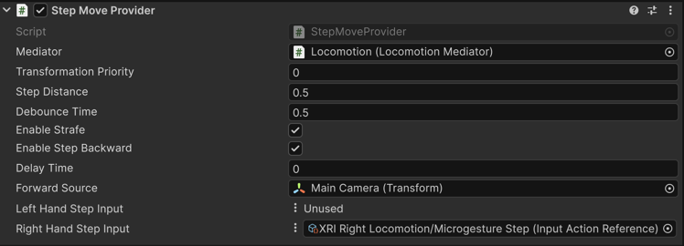

# Step Move Provider

A locomotion provider that allows the user to move their rig a fixed distance forward, backward, left, or right using a 2D axis input from an input system action, such as a hand microgesture swipe or a thumbstick.

| **Property** | **Description** |
|---|---|
|**Mediator**| The behavior that this provider communicates with for access to the mediator's XR Body Transformer. If one is not provided, this provider will attempt to locate one during its `Awake` or `OnEnable` call. |
|**Transformation Priority**| The queue order of this provider's transformations of the XR Origin. The lower the value, the earlier the transformations are applied. |
| **Step Distance** | The distance, in meters, Unity moves the rig with each step. |
| **Debounce Time** | The amount of time that Unity waits before starting another step. |
| **Enable Strafe** | Controls whether to enable left and right steps. |
| **Enable Step Backward** | Controls whether to enable backward steps. |
| **Delay Time** | The time (in seconds) to delay the first step after receiving initial input for the step. Subsequent steps while holding down input are delayed by the **Debounce Time**, not the delay time. This delay can be used, for example, as time to set a tunneling vignette effect as a VR comfort option. |
| **Forward Source** | The source `Transform` that defines the forward direction. If not set, Unity uses the camera of the XR Origin. |
| **Left Hand Step Input** | Reads input data from the left hand. Input Action must be a Value action type (Vector 2). |
| **Right Hand Step Input** | Reads input data from the right hand. Input Action must be a Value action type (Vector 2). |
