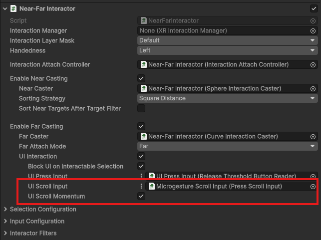

# Scroll UI with XR input

The [Near-Far Interactor](near-far-interactor.md) and [XR Ray Interactor](xr-ray-interactor.md) can scroll the uGUI Scroll Rect or UI Toolkit Scroll View they point at with their ray. On controllers, the thumbstick is primarily used to scroll UI and provides continuous input.

To set up scrolling, enable **UI Interaction** on the interactor and assign the input to **UI Scroll Input**. The `XR Origin (XR Rig)` prefab in the [Starter Assets](xref:xri-samples-starter-assets) sample is already set up this way, with the `UI Scroll` action bound to each thumbstick.

The scene also needs to be set up for your UI system. Refer to [Set up UI Canvases for XR](xref:xri-ui-setup) and [XR UI Input Module](xref:xri-ui-input-module) for uGUI, or [World-space UI Toolkit support](xref:xri-ui-world-space-ui-toolkit-support) for UI Toolkit.

## Scroll with single presses and microgestures

To scroll with microgesture swipes or button presses, use a [Press Scroll Input](press-scroll-input.md). Each press scrolls a fixed distance. Use one per hand or controller.

To scroll with microgestures:

1. Enable the **Hand Interaction Profile Microgestures** feature in the OpenXR settings.
2. Create a **Value** action with a **Vector2** control type and add a **2D Vector** composite binding. Bind **Up** to `<HandInteractionMicrogestures>{LeftHand}/swipeForward`, **Down** to `swipeBackward`, **Left** to `swipeLeft`, and **Right** to `swipeRight`. Use `{RightHand}` for the right hand. Add an **Invert Vector 2** processor to the action with **Invert Y** disabled, so horizontal swipes scroll the same direction as the thumbstick. The [Starter Assets](xref:xri-samples-starter-assets) sample includes these as the `XRI Left Interaction/Microgesture Scroll` and `XRI Right Interaction/Microgesture Scroll` actions.
3. Under each hand in your XR Origin, create a child GameObject, such as `Microgesture Scroll Input`, and add a **Press Scroll Input** component.
4. On the Press Scroll Input, set **Scroll Input** to **Input Action Reference** and assign the action for that hand.
5. On the Near-Far Interactor or XR Ray Interactor, set **UI Scroll Input** to [Object Reference](xref:xri-input-readers#object-reference) and assign the Press Scroll Input.
6. Enable **UI Scroll Momentum** on the interactor so each press glides to a stop. Without it, a uGUI Scroll Rect jumps the full distance at once, and a UI Toolkit Scroll View scrolls by its own wheel step instead of **Scroll Amount**.

 *A Near-Far Interactor using a Press Scroll Input as its UI Scroll Input, with UI Scroll Momentum enabled.*

The `XR Origin Hands (XR Rig)` prefab in the [Hands Interaction Demo](xref:xri-samples-hands-interaction-demo) sample is already set up this way.

To scroll with buttons, follow steps 2 to 6 and bind the buttons to the **2D Vector** composite instead. Refer to [Bind Scroll Input](xref:xri-press-scroll-input#bind-scroll-input) for more binding options.

### UI Scroll Momentum

**UI Scroll Momentum** makes each scroll glide to a stop instead of jumping to the end of the scroll. It's intended to be used with microgesture swipes and button presses, where each press would otherwise move the content all at once.

Enable **UI Scroll Momentum** on the interactor when you scroll with single presses. It's off by default, and can also work with a thumbstick.

Each scroll view sets how quickly its momentum slows down:

* **uGUI:** the Scroll Rect's **Deceleration Rate**, while **Inertia** is enabled. With **Inertia** disabled, the scroll applies at once.
* **UI Toolkit:** the Scroll View's **Scroll Deceleration Rate**.

The deceleration rate is the fraction of speed left after one second, so a higher value glides longer. It sets how long a scroll glides, not how far. Values above `0.99` are treated as `0.99`, so the scroll always stops.

## Scroll distance

**Scroll Amount** on the Press Scroll Input is the same for every scroll view. If your scroll views are different sizes and a press scrolls too far on one or not far enough on another, adjust that scroll view instead:

* **uGUI:** set **Scroll Sensitivity** on the Scroll Rect. Each press scrolls **Scroll Amount** multiplied by this value, so `0.5` scrolls half as far.
* **UI Toolkit:** set **Mouse Wheel Scroll Size** on the Scroll View. Each press scrolls **Scroll Amount** scaled against the default of `18`, so `9` scrolls half as far.

These settings also change thumbstick and mouse wheel scrolling on that scroll view.

## Additional resources

* [Press Scroll Input](press-scroll-input.md)
* [Near-Far Interactor](near-far-interactor.md)
* [XR Ray Interactor](xr-ray-interactor.md)
* [Set up UI Canvases for XR](xref:xri-ui-setup)
* [World-space UI Toolkit support](xref:xri-ui-world-space-ui-toolkit-support)
