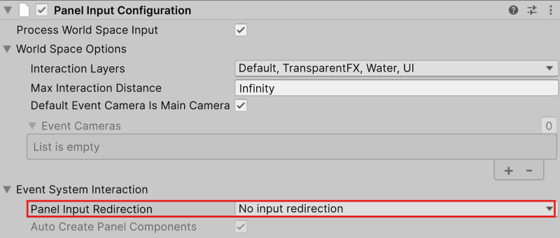
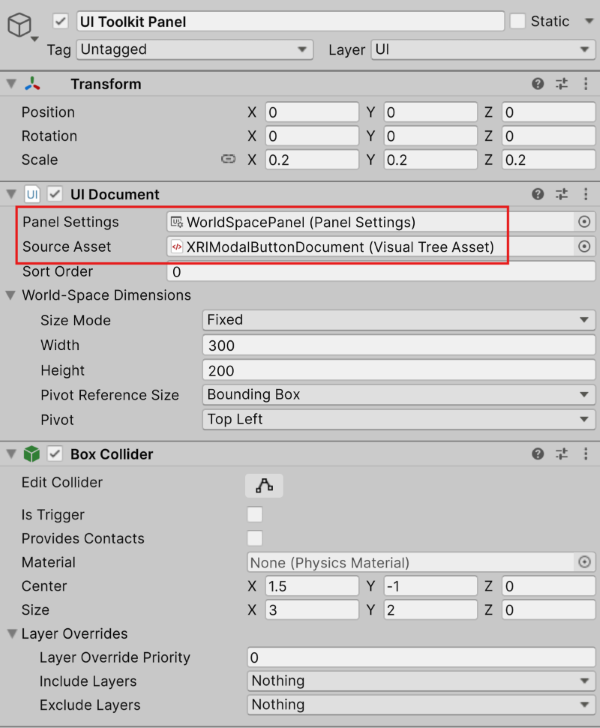
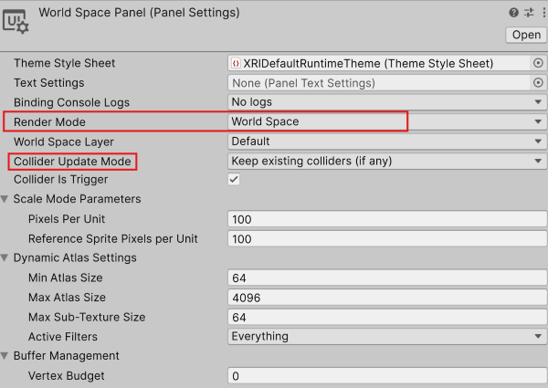
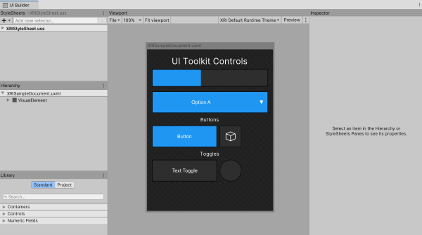
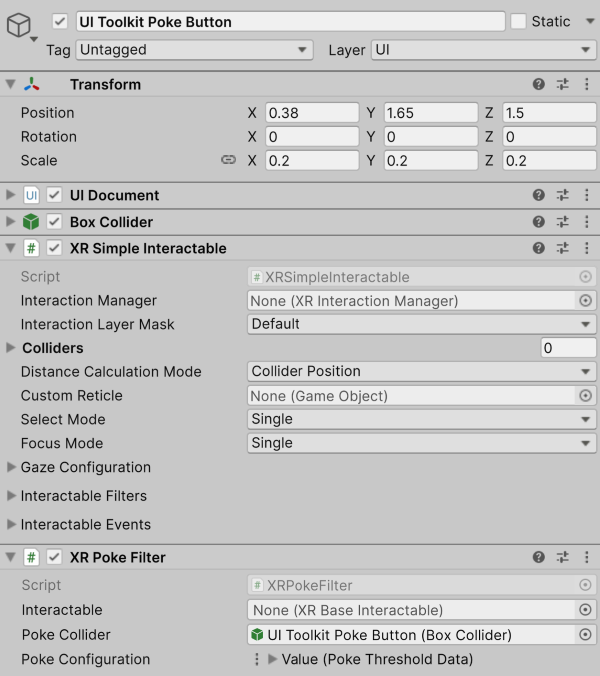
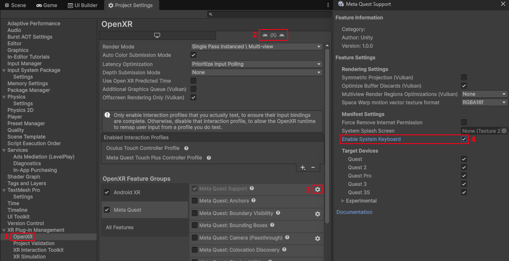
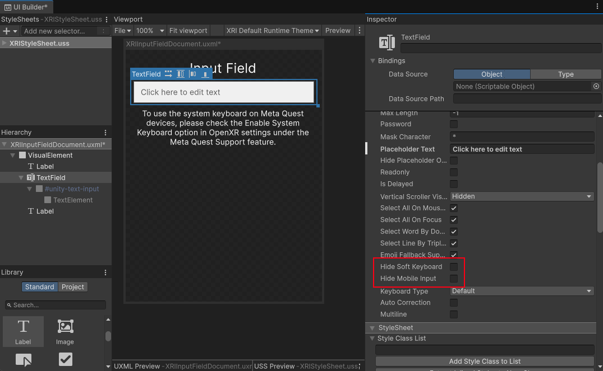
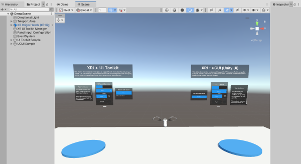

# XR Interaction Toolkit + UI Toolkit

XR Interaction Toolkit has world space UI support using [UI Toolkit](https://docs.unity3d.com/7000.0/Documentation/Manual/UIElements.html) in addition to the existing uGUI support, see [UI Toolkit + uGUI](#ui-toolkit--ugui).

### Panel components and required versions

A world space UI Toolkit panel is hosted by a *panel component* on a GameObject. XR Interaction Toolkit supports two panel components:

| **Panel component** | **Minimum Unity** | **Minimum XR Interaction Toolkit** |
|---|---|---|
| `UIDocument` | `6.2` | `3.2.0` |
| `PanelRenderer` | `7.0` | `7.0.0` |

The rest of this page applies to both and refers to them as the *panel component*, except where noted.

## Getting Started

### Scene Configuration

There are some scene configuration steps necessary to enable world space UI Toolkit support in conjunction with XR Interaction Toolkit.

> [!NOTE]
> This configuration is already complete in the XRI [World Space UI sample](xref:xri-samples-world-space-ui) demo scene which can be imported into projects through the Package Manager window. Open Package Manager by navigating to **Window** &gt; **Package Manager**, then select **XR Interaction Toolkit** package in the left side bar, and select the **Samples** tab. Scroll and locate the `World Space UI` sample and click **Import**.

#### Panel Input Configuration

The event system can interfere with UI Toolkit input, so a properly configured `Panel Input Configuration` component is required in the scene.

To properly configure this component, set the **Panel Input Redirection** field to **No input redirection**. This configuration is pictured below.

#### Enable UI Toolkit Support

To enable UI Toolkit support for XRI, add an XR UI Toolkit Manager component to the scene. `XRUIToolkitManager` is a component that globally enables or disables UI Toolkit support with XR Interaction Toolkit components. When the `XRUIToolkitManager` component is enabled, the `uiToolkitSupportEnabled` property in the `XRUIToolkitHandler` is automatically enabled. When the `XRUIToolkitManager` is disabled, the `uiToolkitSupportEnabled` property in the `XRUIToolkitHandler` is automatically disabled.

By adding a `XRUIToolkitManager` to the scene, this support will be enabled or disabled automatically with the enabled state of the component.

#### UI Toolkit + uGUI

When using both uGUI and UI Toolkit together, `bypassUIToolkitEvents` property on the `XRUIInputModule` should be **disabled**. In the demo scene, the [XR UI Input Module](xref:xri-ui-input-module) component can be found on the **Event System** GameObject.

## Creating World Space UI Toolkit Panel

Basic world space UI panels using UI Toolkit require a `Collider` and a panel component (`UI Document` or `Panel Renderer`). The panel component defines the panel settings, contains the UI source asset, and additional settings like dimensions for the UI panel.

> [!NOTE]
> Use only one panel component on a GameObject. When you switch a panel from a `UI Document` to a `Panel Renderer` (or back), remove the old component rather than disabling it. Otherwise XR Interaction Toolkit can use the disabled component, and the panel won't respond to ray or poke interaction.

See the image below for an example of a base world space UI configuration.

### Panel Settings

An example of panel settings exists in the XRI World Space UI sample, or a new one can be created. To create a new Panel Settings asset, right click in the project Asset folder and select **Create** &gt; **UI Toolkit** &gt; **Panel Settings Assets**. This will generate a new asset in your project. To modify it, select it and use the inspector.

Update the **Render Mode** property in the panel settings asset to **World Space**.

Additionally, the **Collider Update Mode** defines if the panel component will create colliders or use any existing colliders. When set to **Match 2-D document rect**, a collider will be generated on the panel component's GameObject. This can result in duplicate colliders if that GameObject already has a collider (as displayed in the previous image). When set to **Keep existing colliders (if any)**, the panel component will use existing colliders. In this case, it is important that the size of the existing collider matches the panel size.

**Collider Update Mode** is an optional configuration, but will have implications how the GameObjects are configured and how XRI is used. In XRI, if no colliders are assigned to an interactable at runtime that interactable will search for colliders on the GameObject and its children. This can result in interactables incorrectly using panel colliders for interactable interaction. To avoid this, manually assign interactable colliders if there will be a panel component nested as a child. Alternatively, enabling **Is Trigger** on the existing panel collider or setting **Collider Is Trigger** in the panel settings when using **Collider Update Mode** to **Match 2-D document rect** will result in the trigger colliders not being added to the interactable collider list.

> [!NOTE]
> An example of a nested interactable using UI Documents can be found in the UI Toolkit Grab Interactable prefab in the XRI World Space UI sample demo scene.

#### Dynamic collider registration with XRI

When using **Match 2-D document rect** or **Match 3-D bounding box**, UI Toolkit creates the collider dynamically during `LateUpdate` after the panel's first render. This means the collider does not exist when `XRBaseInteractable` discovers colliders during `Awake`. When the [XR UI Toolkit Manager](xref:xri-xr-ui-toolkit-manager) is present in the scene, it monitors for colliders created by UI Toolkit panel components (`UIDocument` or `PanelRenderer`) and registers them with the interactable. If an `XRPokeFilter` component is present, it will also automatically recover when the collider is detected, re-enabling itself and initializing poke interaction. No manual intervention is required.

The manager also handles colliders that are destroyed and recreated. A `UIDocument` destroys its collider when disabled and creates a new one when re-enabled. A `PanelRenderer` keeps its collider while disabled. On Unity 7, the manager subscribes to collider lifecycle events, so the stale reference is cleared and the new collider is registered with the interactable as soon as it changes, while the manager is enabled.

Panels with **Collider Update Mode** set to **Keep existing colliders (if any)** are skipped by the manager since their colliders are manually managed and will not be created or destroyed by the panel component.

The UI Toolkit panel component (`UIDocument` or `PanelRenderer`) must be present on the GameObject before the interactable registers with the Interaction Manager. The manager discovers UI Toolkit panels at registration time. Adding a `UIDocument` or `PanelRenderer` component after the interactable has already registered will not be detected. Changing the **Collider Update Mode** in Panel Settings at runtime is also not supported for dynamic collider registration — the manager determines whether to monitor a panel based on the mode at the time of discovery.

> [!NOTE]
> When using **Match 2-D document rect**, the generated collider has zero thickness along the poke axis. Poke interaction will still function, but the poke press will complete instantly with no depth animation. To enable smooth poke depth animation, use **Match 3-D bounding box** which creates a collider with depth along the poke axis.

### Source Asset

The source asset is the uxml file that defines the layout and styling of the UI to be displayed in the panel. To create a GameObject with a panel component, navigate to the top menu bar and select **GameObject** &gt; **UI Toolkit** &gt; **Panel Renderer**, or **GameObject** &gt; **UI Toolkit** &gt; **Legacy** &gt; **UI Document** for a `UI Document`. The source asset can be created by right clicking the project Asset folder and selecting **Create** &gt; **UI Toolkit** &gt; **UI Document (UXML)**.

To edit the file, double click it or open it in the UI Builder (**Window** &gt; **UI Toolkit** &gt; **UI Builder**).

> [!NOTE]
> For more information on building UI with the UI Builder, please refer to [UI Builder manual page](https://docs.unity3d.com/7000.0/Documentation/Manual/UIBuilder.html)

With the [scene configuration](#scene-configuration) complete, the panel component configured, and the `Collider` added, the UI Toolkit panel is ready for base ray interaction with XRI.

### Poke Interaction Support

To enable poke support that works with the `XRPokeInteractor`, additional components are required on the UI Toolkit panel.

Adding an `XRSimpleInteractable` component and an `XRPokeFilter` component in addition to the `Collider` and the panel component enables poke support on that world space UI panel.

> [!NOTE]
> Poke is supported with both hands and controllers.

UI Toolkit `Button`, `Toggle`, and `Visual Element` all support z-depth with poke. Use the Translate style to set the initial z-depth of the UI element. This can be done via the UI Builder (Transform > Translate > Z) or by programmatically updating the style. The initial z-depth (relative to parent) is cached upon an interactors first interaction with the UI element, and the UI element depth will be reset to that initial z-depth when the interaction ends.

> [!Note]
> Because the UI Toolkit support relies on a collider around the panel, there can be unexpected behavior if the z-depth of the UI Element protrudes out from the panel's box collider. The poke interaction won't be processed until the collider is reached, at which point the poke z-depth processing will begin.

### Input Field Support

Input Fields are currently only supported by using the software/system keyboard built into the appropriate device. To use the system or software keyboard on Meta Quest platforms, you will need to install a minimum version of 1.17.0 of OpenXR and then enable the appropriate feature by navigating to **Project Settings &gt; XR Plugin Management &gt; OpenXR &gt; OpenXR Feature Groups &gt; Meta Quest &gt; Meta Quest Support settings** and checking the box for **Enable System Keyboard**.

Additionally, you will need to make sure you are not hiding soft keyboard or mobile input in order to ensure the operating system on the device receives the correct events to present the keyboard. The attributes that should be unchecked are called **Hide Soft Keyboard** and **Hide Mobile Input** and can be found in the **UI Builder** Inspector area for `TextField` element types.

## UI Hover Events

When an interactor that implements the [`IUIHoverInteractor`](xref:UnityEngine.XR.Interaction.Toolkit.UI.IUIHoverInteractor) interface is hovering over a `Visual Element` of any type, the interactor will receive the appropriate [`OnUIHoverEntered(UIHoverEventArgs)`](xref:UnityEngine.XR.Interaction.Toolkit.UI.IUIHoverInteractor.OnUIHoverEntered(UnityEngine.XR.Interaction.Toolkit.UI.UIHoverEventArgs)) or [`OnUIHoverExited(UIHoverEventArgs)`](xref:UnityEngine.XR.Interaction.Toolkit.UI.IUIHoverInteractor.OnUIHoverExited(UnityEngine.XR.Interaction.Toolkit.UI.UIHoverEventArgs)) calls and raise the [`UIHoverEnterEvent`](xref:UnityEngine.XR.Interaction.Toolkit.UI.UIHoverEnterEvent) or [`UIHoverExitEvent`](xref:UnityEngine.XR.Interaction.Toolkit.UI.UIHoverExitEvent) event that you can subscribe to. The [`UIHoverEventArgs`](xref:UnityEngine.XR.Interaction.Toolkit.UI.UIHoverEventArgs) contain additional details relevant to UI Toolkit types, including the [`visualElement`](xref:UnityEngine.XR.Interaction.Toolkit.UI.UIHoverEventArgs.visualElement) and the [`panelComponent`](xref:UnityEngine.XR.Interaction.Toolkit.UI.UIHoverEventArgs.panelComponent), which is the `UIDocument` or `PanelRenderer` hosting the element. The [`uiDocument`](xref:UnityEngine.XR.Interaction.Toolkit.UI.UIHoverEventArgs.uiDocument) property is deprecated and is `null` for a `PanelRenderer`; use `panelComponent` instead. If subscribing to these events, the UI framework type, typically uGUI (Unity UI) or UI Toolkit, can be determined by checking the [`uiSystem`](xref:UnityEngine.XR.Interaction.Toolkit.UI.UIHoverEventArgs.uiSystem) property stored in the args parameter.

## Examples

The **World Space UI** sample found in the XR Interaction Toolkit samples in Package Manager provides a demo scene that shows how to configure world space UI in both UI Toolkit as well as uGUI. To import, open the Package Manager by going to **Window** &gt; **Package Manager**, then select XR Interaction Toolkit package in the left side bar, and select the Samples tab. Scroll and locate the World Space UI sample and click Import.

## Known limitations

> [!IMPORTANT]
> When using an XR headset in play mode in the Unity Editor, such as over Meta Horizon Link, it may seem as though input is not working with UI Toolkit objects in the scene. This is because input will not be redirected to UI Toolkit unless the Game View is in focus. Bringing the Game View into focus can be done by simply clicking anywhere inside the Game View window.

- Nested elements can impede z-depth support for poke. A `Visual Element` that is a child of a `Visual Element` with z-depth can block the poke interaction on the parent and prevent the poke interaction updating z-depth. This is handled for `Button` and `Toggle`, but should be kept in mind when applying poke z-depth to generic `Visual Element` containers.
